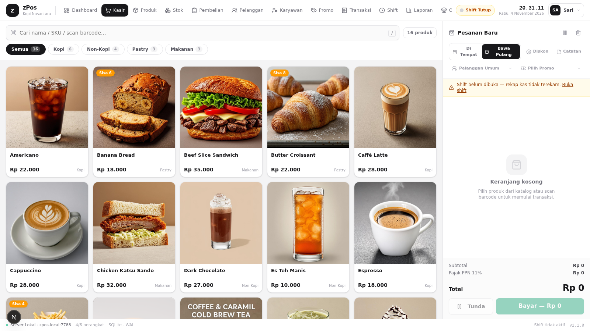
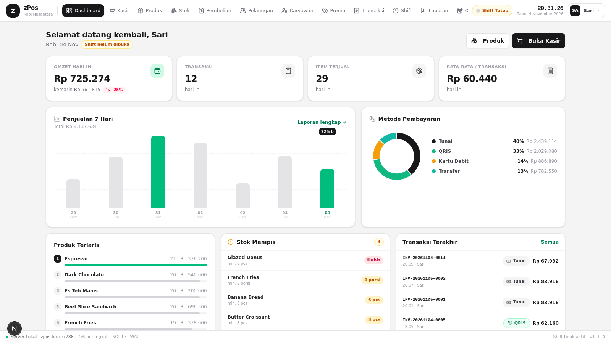
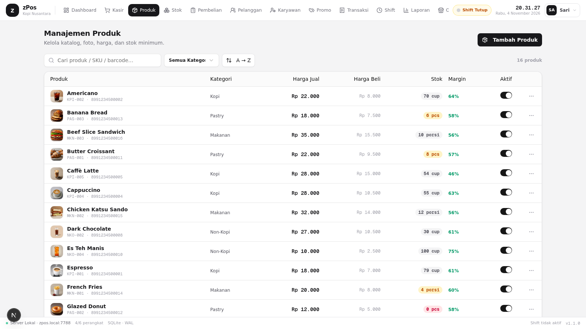
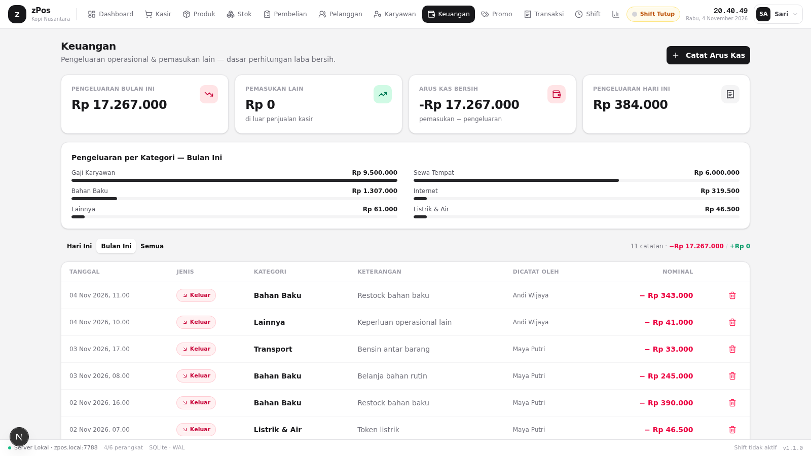
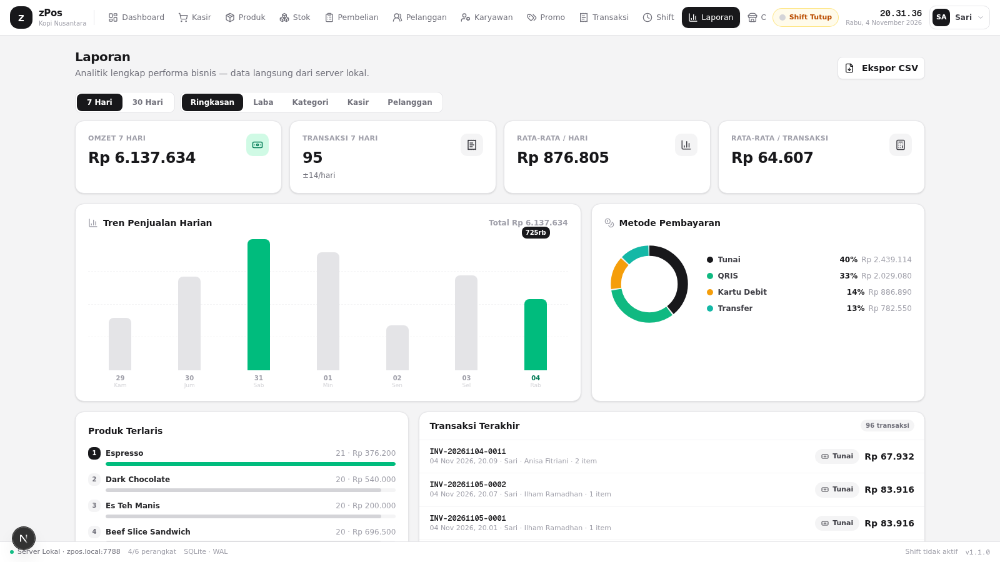

<div align="center">

# zPos

**Kasir & Manajemen Ritel Offline-First — Satu Kesatuan Aplikasi untuk Bisnis Anda**

Terinspirasi iPos & KeToko, dirancang sebagai generasi berikutnya: server lokal di PC/homeserver,
multi-perangkat via WiFi/LAN, data 100% milik Anda.

`Electron` · `Next.js` · `TypeScript` · `Prisma` · `SQLite (WAL)`

[](../../actions)
[](../../releases)

</div>

---

## ✨ Fitur

| Modul | Keterangan |
|---|---|
| 🖥️ **Dashboard** | Omzet hari ini, tren 7 hari, metode pembayaran, produk terlaris, stok menipis |
| 🛒 **Kasir (POS)** | Grid produk + kategori, scan barcode, diskon item & order, promo & member, parkir pesanan, struk thermal 80mm |
| 📦 **Produk** | Katalog + foto, barcode, HPP vs harga jual, margin otomatis, stok minimum |
| 🗃️ **Stok** | Mutasi terkelola (StockMove), stok masuk/keluar/opname, riwayat lengkap |
| 🚚 **Pembelian & Supplier** | PO ke pemasok, stok masuk otomatis saat diterima, direktori supplier |
| 👥 **Pelanggan** | Membership (regular/silver/gold), poin, riwayat belanja |
| 💰 **Keuangan** | Pengeluaran operasional & pemasukan lain — dasar laba bersih |
| 🎟️ **Promo** | Diskon persen/nominal dengan minimum belanja & periode |
| 🧾 **Transaksi** | Riwayat invoice, detail item, pembatalan ber-PIN dengan pengembalian stok |
| ⏱️ **Shift** | Buka/tutup kas, X-Report & Z-Report, rekonsiliasi kas |
| 📊 **Laporan** | Ringkasan, laba kotor → **laba bersih** (dikurangi beban), kategori, kasir, pelanggan, ekspor CSV |
| 🏪 **Outlet** | Siap multi-cabang |
| 🧑‍💼 **Karyawan** | Role owner/manager/kasir/gudang dengan PIN |
| 📡 **Server** | Monitoring perangkat yang terhubung ke server lokal |

## 🏗️ Arsitektur

```
┌────────────────────────── PC / Homeserver (.exe) ──────────────────────────┐
│  zPos Desktop (Electron)                                                   │
│  ├─ Server lokal : Next.js standalone (port 7788)                          │
│  ├─ Database     : SQLite + WAL (Prisma) — tersimpan di userData           │
│  └─ UI           : jendela Electron → http://127.0.0.1:7788                │
└─────────────┬──────────────────────────────────────────────────────────────┘
              │ WiFi / LAN (device lain membuka http://zpos.local:7788)
   ┌──────────┴───────────┬────────────────────┐
   ▼                      ▼                    ▼
 Kasir tablet         Mobile kasir         Browser lain
```

- **Offline-first** — semua transaksi tersimpan di server lokal, tanpa internet.
- **Satu sumber data** — qty stok tidak pernah diubah langsung; selalu lewat `StockMove`.
- **Invoice berurutan tanpa gap** per hari (`INV-YYYYMMDD-0001`).

## 🚀 Menjalankan (Development)

```bash
bun install
bun run db:push     # siapkan SQLite
bun run dev         # http://localhost:3000
```

Data demo (produk, 30 hari transaksi, pembelian, keuangan) akan ter-seed otomatis
saat database kosong.

## 📦 Build Desktop (.exe)

### Lewat GitHub Actions (otomatis)
1. Push ke `main` → tab **Actions** → *Build Desktop (Windows .exe)* → unduh artifact `zPos-Windows-Setup-x64`.
2. Push tag `v*` → installer .exe otomatis dilampirkan ke **Releases**.

### Lokal (Windows)
```bash
npm install
npm run app:build   # next build + electron-builder → dist/zPos-Setup-<versi>.exe
```

Installer NSIS: shortcut desktop + start menu, database di `%APPDATA%/zPos/zpos.db`,
data demo ter-seed otomatis pada menjalankan pertama.

## 🖼️ Tangkapan Layar

| Kasir | Dashboard |
|---|---|
|  |  |

| Produk | Keuangan | Laporan |
|---|---|---|
|  |  |  |

## 🗺️ Roadmap

- [ ] Sinkronisasi multi-outlet (replikasi antar server)
- [ ] QRIS dinamis + e-wallet
- [ ] Aplikasi mobile (Expo) untuk kasir & owner
- [ ] Cetak label barcode & harga
- [ ] Hutang/piutang pelanggan & supplier
- [ ] Pairing perangkat via QR + PIN

## 📄 Struktur Proyek

```
├─ electron/main.js          # shell desktop (spawn server, splash, window)
├─ electron-builder.yml      # konfigurasi packaging .exe
├─ prisma/schema.prisma      # model data (Product, Sale, Shift, CashEntry, ...)
├─ src/app/api/              # REST API (bootstrap, sales, products, cashflow, ...)
├─ src/components/zpos/      # seluruh modul UI
├─ src/lib/                  # store zustand, seed demo, format, types
└─ docs/zpos-master-plan.md  # master plan arsitektur & roadmap
```

---

<div align="center">
<sub>Dibangun dengan ♥ untuk UMKM Indonesia — zPos v1.1.0</sub>
</div>
